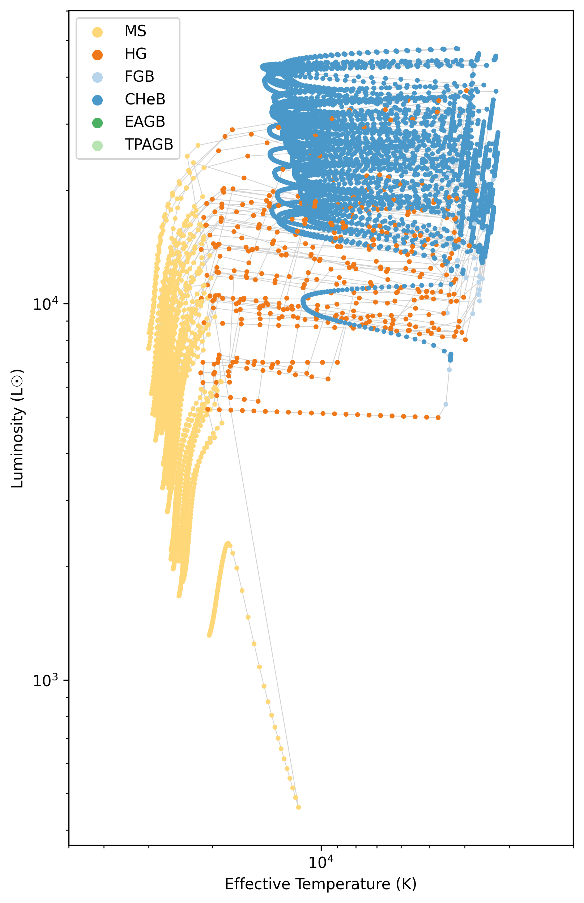
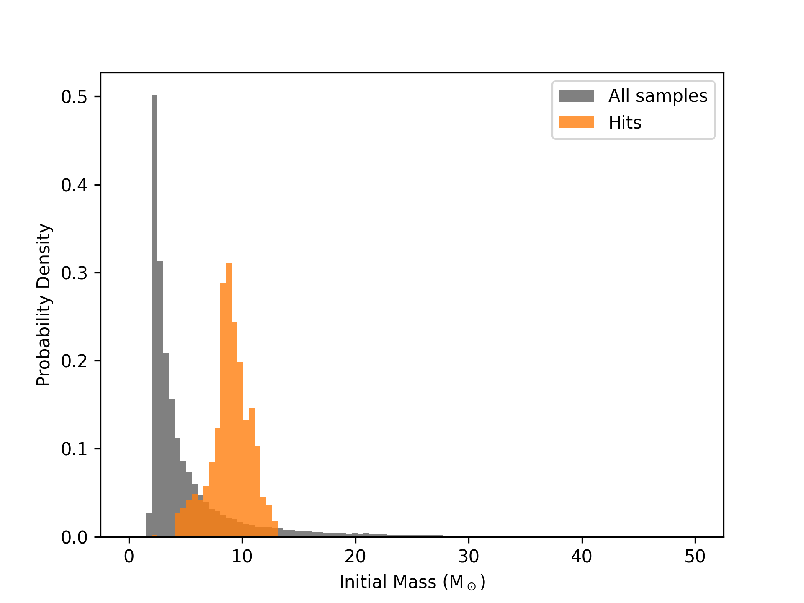
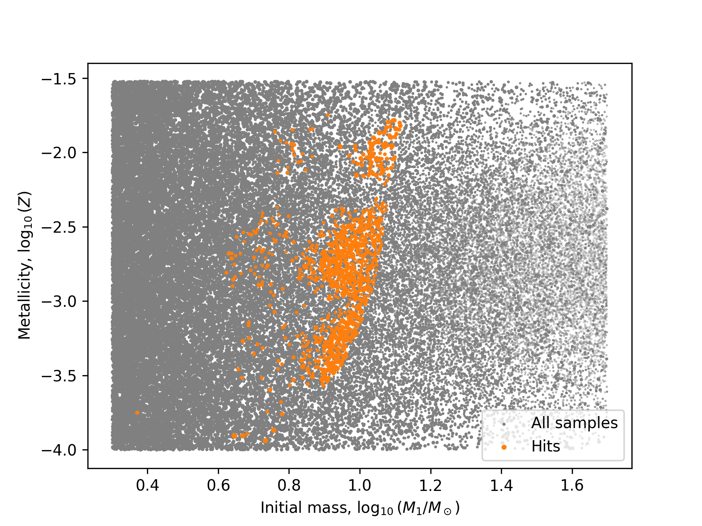

.. _adaptive_kwargs:

******************************************************
Apply timestep conditions and change evolution columns
******************************************************

As in regular ``COSMIC`` runs, you can apply timestep conditions and change the columns in the ``bpp`` and ``bcm`` tables. The :class:`~cosmic.sample.stroopwafel.AdaptiveSampler` accepts the regular ``timestep_conditions``, ``bpp_columns``, and ``bcm_columns`` keyword arguments, which are passed to the underlying ``COSMIC`` :meth:`~cosmic.evolve.Evolve.evolve` method. For some background, check out :ref:`evolve_single` for details about columns and :ref:`timesteps_resolution` for details about timestep conditions.

Blue loops - a worked example
-----------------------------

Now let's demonstrate using them all in an example. Let's say we want to adaptively sample systems with a primary star that underwent a blue loop that exceeds a certain temperature. You can imagine, if we adapted based on the ``bpp`` table, we might miss a brief phase of evolution where the binary hits this phase. The ``bpp`` table is great for identifying hits when they gets rows in ``bpp`` (i.e. have a corresponding ``evol_type``). But sometimes, you need more time resolution for custom situations like this. So, we can use the ``timestep_conditions`` to ensure we have enough time resolution to catch this. Then, we can use the ``bpp_columns`` and ``bcm_columns`` to change the columns in the output tables to only include the information we care about.

To be specific, our criteria for a hit is that the primary star:
    - Reaches the core helium burning phase (``kstar_1 == 4``)
    - During this phase its temperature increases by at least a factor of 5
    - By the end of the phase, the temperature is not more than double the initial temperature

So for this we need to:
    1. Report timesteps during the core helium burning phase, so we can check for the temperature increase
    2. Use the ``bcm`` table to condition the ``is_interesting`` function
    3. Write a custom ``is_interesting`` function that checks for the temperature increase and final temperature condition

Step 1: Add timestep conditions
^^^^^^^^^^^^^^^^^^^^^^^^^^^^^^^

First, we can make it so that extra timesteps are reported during the core helium burning phase. We can do this by adding a timestep condition that says "if the stellar type is 4, then set the timestep to 0.0". In this case, dtp=0.0 just means "report every timestep used internally by ``COSMIC``". We'll also add some other timestep conditions to make sure we have enough time resolution during the main sequence and Hertzsprung gap phases so the Hertzsprung-Russell diagram looks nice. So we can do:

.. code-block:: python

    timestep_conditions = [
        ["kstar_1<2", "dtp=1.0"],
        ["1<kstar_1<4", "dtp=0.01"],
        ["kstar_1=4", "dtp=0.0"],
        ["4<kstar_1<10", "dtp=0.5"],
    ]

Step 2: Change the output columns
^^^^^^^^^^^^^^^^^^^^^^^^^^^^^^^^^

Next, we can change the output columns in the ``bpp`` and ``bcm`` tables to only include the information we care about. In this case, we only care about the temperature of the stars, so we can just include that, the luminosity (for an HR-diagram later) and the basic required columns for the ``bpp`` and ``bcm`` tables. So we can do:

.. code-block:: python

    cols = [
        "tphys", "mass_1", "mass_2", "kstar_1", "kstar_2",
        "evol_type", "porb", "ecc",
        "teff_1", "teff_2", "lum_1", "lum_2"
    ]

Step 3: Write a custom is_interesting function
^^^^^^^^^^^^^^^^^^^^^^^^^^^^^^^^^^^^^^^^^^^^^^

Finally, we can write a custom ``is_interesting`` function that checks for the temperature increase and final temperature condition. This function will take in a ``bcm`` table for all systems in a batch and return the number of hits and a boolean array of which systems are hits.

.. code-block:: python

    def has_blue_loop(bcm):
        cHeb_rows = bcm["kstar_1"] == 4
        cHeb_bin_nums = bcm["bin_num"][cHeb_rows].unique()

        initial_temp = bcm["teff_1"][cHeb_rows].drop_duplicates(subset="bin_num", keep="first")
        final_temp = bcm["teff_1"][cHeb_rows].drop_duplicates(subset="bin_num", keep="last")
        max_temp = bcm["teff_1"][cHeb_rows].groupby("bin_num").max()

        hit_cheb_nums = cHeb_bin_nums[(max_temp >= 5 * initial_temp) & (final_temp <= 2 * initial_temp)]

        bin_nums = bcm["bin_num"].unique()
        is_hit = np.isin(bin_nums, hit_cheb_nums)

        return is_hit.sum(), is_hit

Put it all together
^^^^^^^^^^^^^^^^^^^

Now we can put it all together and run an adaptive sampling simulation with these conditions. We can do this by passing the ``timestep_conditions``, ``bpp_columns``, ``bcm_columns``, and ``is_interesting`` function to the :class:`~cosmic.sample.stroopwafel.AdaptiveSampler` (remember to set the ``is_interesting_args`` to use the ``bcm`` table):

.. include:: ../../../_generated/default_bsedict.rst

.. code-block:: python

    import numpy as np
    from cosmic.sample.stroopwafel import ParameterSpace, Parameter, AdaptiveSampler

    def derive_params(sampled):
        """Provide binary parameters not drawn from the ParameterSpace."""
        return {'mass_2': sampled['mass_1'] * sampled['q']}

    params = ParameterSpace([
        Parameter('mass_1',      2.0,        50.0,       dist='kroupa'),
        Parameter('q',           0.01,       1.0,        dist='uniform'),
        Parameter('porb',        10**(0.15), 10**(5.5),  dist='sana'),
        Parameter('ecc',         1e-9,       0.9999,     dist='sana_ecc'),
        Parameter('metallicity', 0.0001,     0.03,       dist='flat_in_log'),
    ])
    SSEDict = {'stellar_engine': 'sse'}

    sampler = AdaptiveSampler(
        parameter_space=params,
        total_systems=50000,
        batch_size=2500,
        BSEDict=BSEDict,
        SSEDict=SSEDict,
        is_interesting=has_blue_loop,
        is_interesting_args=["bcm"],
        derive_params=derive_params,
        reject_systems="default",
        nproc=4,
        seed=117,
        timestep_conditions=timestep_conditions,
        bpp_columns=cols,
        bcm_columns=cols,
    )
    results = sampler.run()
    hits = results[results.is_hit]
    hit_nums = hits.bpp.index.unique().values

Then we can make some plots. Let's take a look at a random 50 systems that met our hit criteria and plot their HR-diagrams:

.. code-block:: python

    kstar_translator = [
        {'long': 'Main Sequence (Low mass)', 'short': 'MS < 0.7', 'colour': (0.996078, 0.843476, 0.469158, 1.0)},
        {'long': 'Main Sequence', 'short': 'MS', 'colour': (0.996078, 0.843476, 0.469158, 1.0)},
        {'long': 'Hertzsprung Gap', 'short': 'HG', 'colour': (0.939608, 0.471373, 0.094902, 1.0)},
        {'long': 'First Giant Branch', 'short': 'FGB', 'colour': (0.716186, 0.833203, 0.916155, 1.0)},
        {'long': 'Core Helium Burning', 'short': 'CHeB', 'colour': (0.29098, 0.59451, 0.78902, 1.0)},
        {'long': 'Early AGB', 'short': 'EAGB', 'colour': (0.294902, 0.690196, 0.384314, 1.0)},
        {'long': 'Thermally Pulsing AGB', 'short': 'TPAGB',
        'colour': (0.723122, 0.889612, 0.697178, 1.0)},
        {'long': 'Helium Main Sequence', 'short': 'HeMS', 'colour': (0.254627, 0.013882, 0.615419, 1.0)},
        {'long': 'Helium Hertsprung Gap', 'short': 'HeHG', 'colour': (0.562738, 0.051545, 0.641509, 1.0)},
        {'long': 'Helium Giant Branch', 'short': 'HeGB', 'colour': (0.798216, 0.280197, 0.469538, 1.0)},
        {'long': 'Helium White Dwarf', 'short': 'HeWD', 'colour': (0.368166, 0.232828, 0.148275, 1.0)},
        {'long': 'Carbon/Oxygen White Dwarf', 'short': 'COWD', 'colour': (0.620069, 0.392132, 0.249725, 1.0)},
        {'long': 'Oxygen/Neon White Dwarf', 'short': 'ONeWD', 'colour': (0.867128, 0.548372, 0.349225, 1.0)},
        {'long': 'Neutron Star', 'short': 'NS', 'colour': (0.501961, 0.501961, 0.501961, 1.0)},
        {'long': 'Black Hole', 'short': 'BH', 'colour': (0.0, 0.0, 0.0, 1.0)},
        {'long': 'Massless Remnant', 'short': 'MR', 'colour': (1.0, 1.0, 0.0, 1.0)},
        {'long': 'Chemically Homogeneous', 'short': 'CHE', 'colour': (0.647059, 0.164706, 0.164706, 1.0)}
    ]

    fig, ax = plt.subplots(figsize=(6, 10))

    for BIN_NUM in np.random.choice(hit_nums, size=50, replace=False):
        mask = results.bcm["kstar_1"].loc[BIN_NUM] < 7
        ax.plot(
            results.bcm["teff_1"].loc[BIN_NUM][mask],
            results.bcm["lum_1"].loc[BIN_NUM][mask],
            color="lightgrey", zorder=-1, lw=0.5
        )
        ax.scatter(
            results.bcm["teff_1"].loc[BIN_NUM][mask],
            results.bcm["lum_1"].loc[BIN_NUM][mask], s=5,
            c=[kstar_translator[c]['colour']
               for c in results.bcm["kstar_1"].loc[BIN_NUM][mask]],
            rasterized=True
        )
    ax.set(
        xscale="log",
        yscale="log",
        xlabel="Effective Temperature (K)",
        ylabel="Luminosity (L☉)",
        xlim=(5e4, 2e3)
    )

    for kstar in kstar_translator[1:7]:
        ax.scatter([], [], c=[kstar['colour']], label=kstar['short'])

    ax.legend()

    plt.show()

   HR diagram of the first 50 systems that met the blue loop criteria. The color of the points indicates the stellar type of the primary star.

Additionally, we can compare what sorts of systems hit the criteria. Let's compare the initial mass and metallicity of the systems that hit the criteria to those that didn't:

.. code-block:: python

    fig, ax = plt.subplots()

    bins = np.linspace(0, 50, 100)
    ax.hist(results.initC["mass_1"], weights=results.weights, bins=bins,
            density=True, color="grey", label="All samples");
    ax.hist(results.initC["mass_1"][results.is_hit], weights=results.weights[results.is_hit],
            bins=bins, alpha=0.8, density=True, color="tab:orange", label="Hits");
    ax.legend()
    ax.set(
        xlabel="Initial Mass (M$_\odot$)",
        ylabel="Probability Density"
    )
    plt.show()

    fig, ax = plt.subplots()
    ax.scatter(
        np.log10(results.initC["mass_1"]), np.log10(results.initC["metallicity"]),
        s=1 * results.weights, color="grey", label="All samples", rasterized=True
    )
    ax.scatter(
        np.log10(results.initC["mass_1"][results.is_hit]),
        np.log10(results.initC["metallicity"][results.is_hit]),
        s=5 * results.weights[results.is_hit], color="tab:orange",
        label="Hits", rasterized=True
    )
    ax.legend()
    ax.set(
        xlabel=r"Initial mass, $\log_{10}(M_1/M_\odot)$",
        ylabel=r"Metallicity, $\log_{10}(Z)$"
    )
    plt.show()

   Comparison of the initial mass distribution of the systems that hit the blue loop criteria (orange) to those that didn't (grey). The histograms are normalized to show probability density.

   Comparison of the initial mass and metallicity of the systems that hit the blue loop criteria (orange) to those that didn't (grey). The size of the points indicates the weight of the system.

Overall, we can see that the hit systems are located in specific regions of mass-metallicity space, which is what we would expect for systems that undergo blue loops. This demonstrates how you can use the ``timestep_conditions``, ``bpp_columns``, and ``bcm_columns`` keyword arguments to customize your adaptive sampling runs in ``COSMIC``.